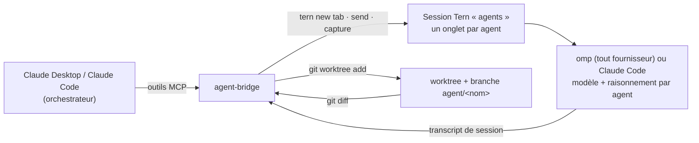

# agent-bridge — orchestrer des agents de code IA en parallèle depuis Claude (serveur MCP)

**agent-bridge** est un serveur MCP qui transforme une conversation Claude (Claude Desktop ou Claude Code) en **orchestrateur d'agents de code IA en parallèle**. Chaque agent tourne dans son propre onglet [Tern](https://docs.stencil.so/tern), sur son propre **worktree git** et sa propre branche. Un agent peut utiliser **n'importe quel modèle disponible sur ta machine** via [omp (oh-my-pi)](https://github.com/can1357/oh-my-pi), ou tourner avec Claude Code.

L'orchestrateur planifie le travail, lance les agents, suit leur avancement, lit leurs rapports et leurs diffs, et leur envoie des corrections. Tu n'as rien à copier-coller entre les deux.

[English](README.md)



## Fonctionnalités

- **Des agents en parallèle, isolés.** Chaque agent a son propre worktree et sa propre branche (`agent/<nom>`). Les agents ne se marchent pas dessus et ne touchent pas à ta copie de travail.
- **Tous les modèles de ta machine.** Le moteur omp utilise tous les modèles qu'omp propose chez toi : Anthropic, OpenAI / Codex, LiteLLM ou autres proxys, modèles locaux, et tout autre fournisseur que tu as configuré. Claude Code est disponible comme second moteur.
- **Un choix de modèle qui reste à jour.** Tu donnes un modèle précis, ou un niveau `auto:fast`, `auto:balanced` ou `auto:frontier`. Ces niveaux sont recalculés à partir du catalogue de modèles en direct : un nouveau modèle y apparaît dès qu'omp le liste. Aucun fournisseur n'est favorisé par défaut.
- **C'est toi qui choisis les modèles autorisés.** Tu donnes une consigne à l'orchestrateur, par exemple « uniquement `openai-codex/*` » ou « frontier = opus ». Il l'enregistre avec `set_model_policy`, et le serveur la fait respecter à chaque lancement.
- **Un niveau de raisonnement par tâche.** Faible pour le mécanique, élevé pour la conception ou les bugs difficiles. Tu peux changer le modèle ou le niveau d'un agent en cours de route, sans perdre son historique.
- **Reprise des sessions existantes.** L'orchestrateur repère les sessions omp et Claude Code déjà ouvertes dans n'importe quelle fenêtre Tern et les pilote sur place. Une session sauvegardée peut être rouverte dans un nouvel onglet, avec tout son historique.
- **Suivi sans intervention.** `wait_for_agents` rend la main quand un agent a fini son tour. Tu récupères le rapport final de chaque agent (section `## Report`), ses commits et un diff complet qui inclut les modifications non commitées. Le serveur te prévient quand un agent semble bloqué sur une approbation ou une boîte de dialogue.
- **Vue en direct.** Chaque agent est un onglet Tern normal : tu peux le regarder travailler ou y taper toi-même.

## Installation rapide

Prérequis :
- macOS (c'est là que l'outil est testé ; Linux devrait fonctionner partout où Tern et omp tournent, mais n'est pas testé) ;
- [Tern](https://docs.stencil.so/tern), lancé ;
- [omp](https://github.com/can1357/oh-my-pi), connecté à au moins un fournisseur ;
- Claude Desktop ou Claude Code, qui servira d'orchestrateur ;
- git.

```sh
curl -LsSf https://raw.githubusercontent.com/merlinh0/agent-bridge/main/install.sh | sh
```

Le script d'installation :
1. installe [uv](https://docs.astral.sh/uv/) si besoin ;
2. installe la commande `agent-bridge` ;
3. l'enregistre dans Claude Desktop et dans Claude Code, après avoir sauvegardé la config de Claude Desktop ;
4. lance `agent-bridge doctor` pour vérifier l'installation.

Ensuite, quitte Claude Desktop (⌘Q) et relance-le.

<details>
<summary>Installation manuelle</summary>

```sh
uv tool install git+https://github.com/merlinh0/agent-bridge
agent-bridge install            # --no-desktop / --no-claude-code / --dry-run
agent-bridge doctor
```
</details>

## Utilisation

Dans une conversation Claude Desktop :

```text
Tu es l'orchestrateur de mes agents de code (outils agent-bridge).
Dépôt : ~/code/mon-app. Objectif : ajouter l'export CSV à la page des rapports, avec des tests.
Consigne modèles : uniquement openai-codex/* et anthropic/claude-sonnet-* ; niveau frontier = openai-codex/gpt-6.1-sol.
Découpe en tâches indépendantes, montre-moi le plan, puis lance un agent par tâche avec le bon niveau de modèle.
Boucle sur wait_for_agents → get_agent → get_diff, corrige avec send_message, et demande-moi avant tout nettoyage.
```

Autres demandes possibles :
- « Liste les sessions omp ouvertes dans Tern et prends le contrôle de celle qui travaille sur l'API. »
- « Rouvre la session d'hier sur la landing et demande-lui de finir les tests. »
- « Relance l'agent `fix-cache` au niveau frontier avec un raisonnement élevé. »

## Outils

| Outil | Rôle |
|---|---|
| `start_agent(repo, task, name?, base?, engine?, model?, thinking?, auto_approve?, worktree?)` | Crée le worktree et la branche `agent/<nom>`, puis lance l'agent dans un onglet Tern |
| `discover_sessions(include_saved?, limit?)` | Liste les sessions omp / Claude Code ouvertes dans Tern (toutes fenêtres) et les sessions sauvegardées récentes |
| `adopt_session(block? \| session_file?, name?, base?)` | Prend le contrôle d'une session ouverte sans la relancer, ou rouvre une session sauvegardée dans un nouvel onglet |
| `list_agents()` / `get_agent(name, history?)` | Donne l'état, le modèle, le niveau de raisonnement, le dernier message (le rapport), les commits et les changements non commités |
| `get_diff(name, path?, stat_only?)` | Montre tout ce qui a changé depuis le commit de base : commits, modifications en cours et nouveaux fichiers |
| `send_message(name, message, model?, thinking?)` | Envoie une suite ou une correction. Si `model` ou `thinking` change, l'agent redémarre sur ce modèle avec tout son historique |
| `wait_for_agents(names?, timeout_s?)` | Attend qu'un agent termine son tour |
| `capture_screen(name)` / `press_keys(name, keys)` | Montre l'écran d'un agent et permet de répondre à une approbation ou une boîte de dialogue |
| `stop_agent(name, cleanup?, force?)` | Ferme l'onglet. Avec `cleanup`, supprime aussi le worktree et la branche, mais refuse s'il reste du travail non fusionné. Une session reprise est seulement oubliée : rien n'est fermé ni supprimé |
| `list_models(engine?, filter?, refresh?)` | Liste tous les modèles disponibles avec leurs niveaux de raisonnement et leur prix, les niveaux auto actuels, et indique si chaque modèle est autorisé |
| `get_model_policy()` / `set_model_policy(allowed_models?, tiers?)` | Lit ou définit les règles sur les modèles |

États d'un agent : `starting`, `working`, `idle` (tour terminé, il attend la suite), `exited`, `closed`.

## Choix des modèles et règles

`model` accepte :
- un sélecteur omp exact, tel que listé par `list_models` (ex. `openai-codex/gpt-6.1-sol`) ;
- pour Claude Code, un modèle ou un alias Claude (`opus`, `sonnet`, `haiku`) ;
- un niveau automatique : `auto:fast`, `auto:balanced` ou `auto:frontier`.

`thinking` va de `off` à `max` pour omp, et de `low` à `max` pour Claude Code (transmis comme `--effort`). Une valeur que le modèle n'accepte pas est refusée, et l'erreur donne les valeurs possibles.

**Comment les niveaux auto sont calculés.** Ils sont recalculés à partir du catalogue en direct (`omp models --json`), sans aucun nom de modèle écrit en dur :
1. on garde les modèles de chat qui ont un prix ;
2. on garde la version la plus récente de chaque famille de modèles (un identifiant sans date passe avant ses copies datées) ;
3. on répartit par prix de sortie : le tiers le moins cher devient `fast`, le tiers le plus cher `frontier`, le reste `balanced`.

Le raisonnement par défaut est `low`, `medium` et `high` respectivement. `list_models(refresh=True)` ou `agent-bridge models --refresh` force la prise en compte d'un modèle qui vient de sortir. Les modèles gratuits ou locaux ne sont jamais choisis automatiquement, mais restent utilisables par leur nom.

**Les règles.** L'orchestrateur appelle `set_model_policy` dès que tu lui donnes une consigne sur les modèles. Elles valent jusqu'au redémarrage du serveur MCP, donc en général jusqu'au redémarrage de l'app. Pour des règles permanentes, mets les deux mêmes clés dans `~/.agent-bridge/config.json` :

```json
{
  "allowed_models": ["openai-codex/*", "anthropic/claude-sonnet-*", "claude-code/*"],
  "tiers": { "frontier": "openai-codex/gpt-6.1-sol" }
}
```

- `allowed_models` est une liste de motifs. Un modèle omp se reconnaît à son sélecteur (`fournisseur/modèle`), un modèle Claude Code à `claude-code/<modèle>`. Une liste vide autorise tout.
- `tiers` fixe le modèle qu'un niveau désigne, à la place du choix automatique.
- Avec une liste d'autorisations, un agent lancé sans modèle reçoit `auto:balanced` parmi les modèles autorisés, au lieu du modèle par défaut du moteur.
- Un modèle non autorisé est refusé au lancement, à la reprise et au changement de modèle.

## FAQ

**Comment faire tourner plusieurs agents en parallèle sans conflit ?** Un worktree et une branche par agent. Tu fusionnes les branches que tu acceptes, puis tu appelles `stop_agent(cleanup=True)`.

**Puis-je utiliser GPT, Codex, des modèles locaux ou d'autres modèles que ceux d'Anthropic ?** Oui : tous les modèles qu'omp propose sur ta machine.

**Ça marche avec claude.ai dans le navigateur ?** Non. Il faudrait exposer sur Internet un serveur qui pilote ton terminal. Utilise Claude Desktop ou Claude Code.

**Et les approbations ?** Par défaut, les agents suivent ta configuration d'approbation habituelle. `capture_screen` montre la demande et `press_keys` y répond. `auto_approve=true` supprime ces arrêts. Il est refusé tant que tu n'as pas lancé toi-même `agent-bridge auto-approve on` ; voir [Sécurité](#sécurité).

**Claude Code demande « Do you trust this folder? »** Une seule fois par dépôt. `press_keys(["Down","Enter"])` répond oui.

## Sécurité

L'orchestrateur lit du texte écrit par les agents (rapports, diffs, écrans du terminal). Un dépôt ou une page web malveillante pourrait donc essayer de le manipuler par ce biais. Le serveur est conçu en conséquence :

- **Les arguments des outils ne sont pas considérés comme sûrs.** Les noms d'agents sont validés, un fichier de session doit être un vrai transcript venant des dossiers de sessions d'omp ou de Claude Code, et rien ne passe par un shell ni n'est interprété comme une option de ligne de commande.
- **`auto_approve` est désactivé tant que tu ne l'actives pas** avec `agent-bridge auto-approve on` dans un terminal. Aucun outil MCP ne peut changer ce réglage.
- **Rien n'est tapé dans un onglet où l'agent ne tourne plus.** Si une session reprise se termine et laisse ton shell à la place, le message suivant rouvre la session dans un nouvel onglet.
- **Le nettoyage ne devine jamais.** `stop_agent(cleanup=True)` refuse s'il reste des fichiers non commités ou des commits non fusionnés, ou s'il n'arrive pas à le vérifier. Une session reprise n'est jamais supprimée.
- **L'état est privé.** `~/.agent-bridge` est créé avec des droits réservés à ton utilisateur.

Ce contre quoi il ne protège pas :

- **Les agents tournent avec tes droits.** Un agent peut faire tout ce que les réglages d'approbation de son moteur autorisent, dans le dépôt que tu lui donnes. Ne lance des agents que sur des dépôts de confiance.
- **Les règles sur les modèles sont une consigne pour l'orchestrateur, pas un bac à sable.** L'orchestrateur peut les modifier avec `set_model_policy`, et une session reprise garde le modèle sur lequel elle tourne déjà.
- **Approuver une demande avec `press_keys` exécute la commande.** Lis l'écran avant.

## Limites

- **Claude Code est moins testé qu'omp comme moteur.** Le lancement, la lecture de l'état et l'envoi de touches ont été vérifiés en conditions réelles ; un tour complet de Claude Code ne l'a pas été.
- **Un onglet Claude Code ouvert n'indique pas quelle session il fait tourner.** L'outil prend l'identifiant de session sur la ligne de commande s'il y en a un, sinon le transcript le plus récent du dossier, et refuse si plusieurs ont été actifs récemment.
- **L'état est lu dans le transcript.** Un agent qui attend sur une boîte de dialogue reste `working` ; l'avertissement après 90 s sans activité est le signal pour regarder son écran.
- **Les niveaux auto classent les modèles par prix.** Le prix est une approximation de la capacité, pas un comparatif ; fixe un modèle par niveau si tu n'es pas d'accord.

## Dépannage

Commence par `agent-bridge doctor`.

| Symptôme | Solution |
|---|---|
| Les outils n'apparaissent pas dans Claude Desktop | ⌘Q puis relancer ; `agent-bridge doctor` |
| `tern CLI not found` | Ouvrir Tern |
| L'agent reste en `starting` | `capture_screen` : connexion, confiance du dossier ou dialogue de démarrage |
| L'agent est en `working` avec un avertissement | `capture_screen` : sans doute une approbation, à régler avec `press_keys` |
| `not allowed by the model policy` | `get_model_policy`, puis choisir un modèle autorisé ou modifier les règles |
| `auto_approve is disabled` | Lancer `agent-bridge auto-approve on` dans un terminal, si tu veux des agents qui exécutent leurs outils sans demander |
| `wait_for_agents` renvoie `timed_out` | Normal : l'outil rend la main avant la limite d'appel MCP. Rappelle-le |

## Licence

[MIT](LICENSE)
